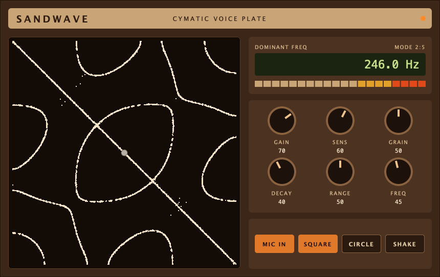
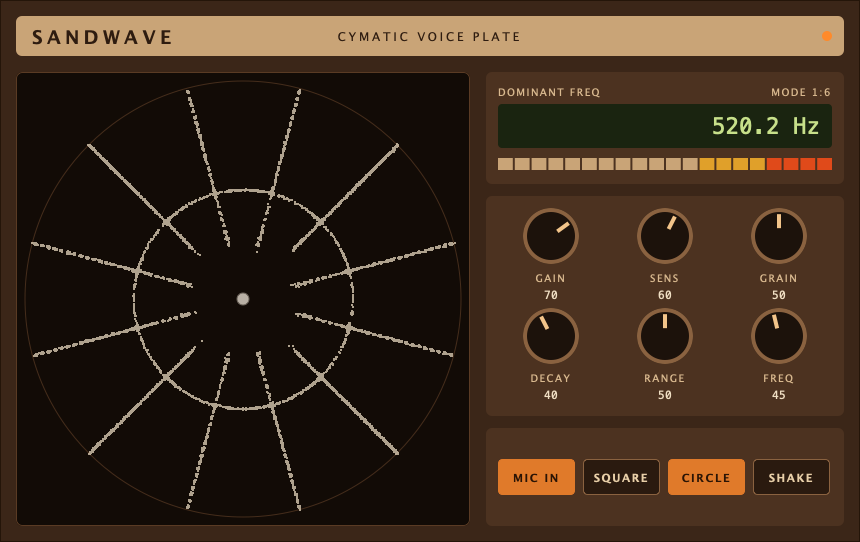
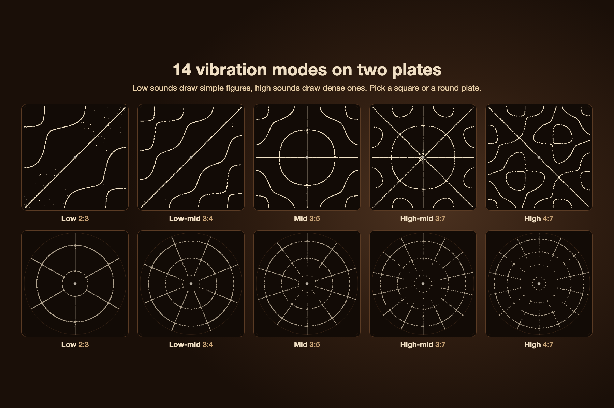
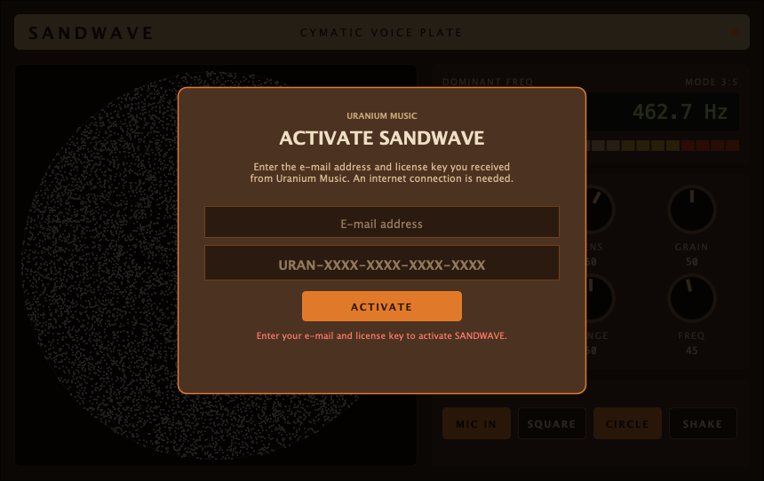
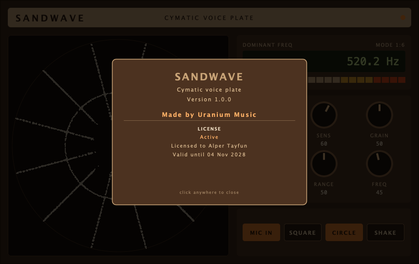

# SANDWAVE — Uranium Music

A cymatics visualizer plugin (VST3 + AU, macOS universal; VST3 on Windows) built with JUCE. It listens to the track's audio (a microphone, a vocal, any sound) and draws it as sand on a vibrating Chladni plate. Audio passes through untouched.



## Features

- **Live analysis**: 4096-point FFT every 1024 samples finds the dominant frequency between 40 Hz and 5 kHz (parabolic peak interpolation; noise without a clear peak is ignored) and the RMS level
- **Chladni plate**: 12,000 grains are shaken in proportion to how strongly their spot on the plate moves, and slide towards the still nodal lines, so the classic figures form and stay put when the sound stops
- **14 vibration modes**: the dominant frequency picks the mode on a log scale from 60 Hz across 3 to 8 octaves (RANGE); square modes alternate between the symmetric (rings) and antisymmetric (crossing lines) shapes
- **Square and round plate**, SHAKE to pour fresh sand
- **Controls**: GAIN (-30..+30 dB), SENS (level floor), GRAIN (jump size), DECAY (ring-out 50 ms..2 s), RANGE, FREQ (manual mode)
- **MIC IN off**: the plate rings at FREQ on its own, like a tone generator driving it, without any input
- **Displays**: dominant frequency LCD, current mode, 20-segment level meter and a ring light
- **Retina**: the sand is drawn at the screen's real resolution

| Round plate | Plate modes |
|---|---|
|  |  |

## Licensing

The plate stays locked and shows an activation dialog until a valid Uranium Music license key is entered (audio still passes through).



- The machine id is the Mac's hardware UUID (`IOPlatformUUID`), on Windows the `MachineGuid`.
- Activation sends the key, the licensee's e-mail, the machine id, `vstName=SANDWAVE` and a nonce to `POST https://uraniummusiclicense.vercel.app/api/verify`.
- After that, on every load the plugin calls `https://uraniummusiclicense.vercel.app/lisencecheck/<md5(key + machineId + UTC date YYYY-MM-DD + "1.618")>?machineId=…&vstName=SANDWAVE&nonce=…`. If the server's signed answer is on a different UTC day (wrong clock, midnight) it retries once with the server's date. An activated plugin opens straight away from its last signed response while that check runs in the background, and is locked again if the server says the license is no longer valid.
- Every server response is **Ed25519-signed**; the server's public key is compiled into the plugin, so a fake server or an edited response cannot unlock it.
- Each request carries a fresh random **nonce** and the **machine id**, both of which must come back inside the signed payload (no replayed responses).
- The license must be `valid` and, unless `lifetime` is true, not past `expiresAt`; otherwise the dialog asks for a new key.
- The key and the last signed response are stored in `~/Library/Application Support/Uranium Music/Sandwave/license.json` (owner-only permissions; `%APPDATA%\Uranium Music\Sandwave` on Windows). Without internet the plugin keeps working for **72 hours** after the last successful check, based on that signed response.
- The license server must list `SANDWAVE` in its VST names for keys to be issued and accepted.
- Signature checking uses [Monocypher](https://monocypher.org) 4.0.2 (`ThirdParty/monocypher`, BSD-2 / CC0).

Click the header to see the version and license status:



## Building

Requirements: Xcode command line tools and CMake (`brew install cmake`).

```bash
git clone --recursive git@github.com:alpertayfun/uraniummusicvstsandwave.git
cd uraniummusicvstsandwave
cmake -B build -DCMAKE_BUILD_TYPE=Release
cmake --build build -j8
```

The plugins are written to `build/Sandwave_artefacts/Release/`. Install them with:

```bash
cp -R build/Sandwave_artefacts/Release/VST3/SANDWAVE.vst3 ~/Library/Audio/Plug-Ins/VST3/
cp -R build/Sandwave_artefacts/Release/AU/SANDWAVE.component ~/Library/Audio/Plug-Ins/Components/
```

Then rescan plug-ins in your DAW (Ableton: Preferences → Plug-Ins → Rescan) and load SANDWAVE on an audio track. For a live microphone, set the track's input to the microphone and turn monitoring on.

`-DSANDWAVE_DEV_UNLOCKED=ON` builds a local test version without the license check. Never ship it.

## Installers

| Platform | Installer | Installs to |
|---|---|---|
| macOS 11+ (Apple Silicon + Intel) | `SANDWAVE-<version>-macOS.dmg` with a `.pkg` inside | `/Library/Audio/Plug-Ins/VST3` and `/Library/Audio/Plug-Ins/Components` |
| Windows 10+ (x64) | `SANDWAVE-<version>-Windows-Setup.exe` (Inno Setup) | `C:\Program Files\Common Files\VST3` |

**Build them on GitHub:** Actions → *Installers* → *Run workflow*. Both files appear as artifacts of the run. Pushing a tag such as `v1.0.0` builds them and attaches them to a GitHub release.

**Build the macOS one locally:**

```bash
cmake -B build -DCMAKE_BUILD_TYPE=Release && cmake --build build -j8
packaging/mac/build_dmg.sh        # -> dist/SANDWAVE-<version>-macOS.dmg
```

Without Apple Developer ID certificates the plugins are ad-hoc signed and the installer is unsigned, so macOS asks users to right-click → Open the installer. Set `MAC_APP_SIGN_IDENTITY` / `MAC_INSTALLER_SIGN_IDENTITY` (locally or as repository secrets) to sign properly; notarization would be the next step.

## Tools

`SandwaveSnapshot` (not built by default) renders the editor to PNG, tests the analysis and runs the license tests:

```bash
cmake --build build --target SandwaveSnapshot
build/SandwaveSnapshot_artefacts/Release/SandwaveSnapshot shots                 # analysis tests + screenshots
build/SandwaveSnapshot_artefacts/Release/SandwaveSnapshot --store store/raw     # 2x renders for the store images
ACID_TEST_UUID=$(ioreg -rd1 -c IOPlatformExpertDevice | awk -F'"' '/IOPlatformUUID/{print $4}') ACID_TEST_KEY=<a real key> ACID_TEST_EMAIL=<its e-mail> build/SandwaveSnapshot_artefacts/Release/SandwaveSnapshot --license-test "$PWD/shots/lictest"   # license tests
```

## Store

`store/` holds the Gumroad material: `gumroad-description.md` (product page), `gumroad-content.md` (what buyers see after purchase), the cover (1280×720), thumbnail (600×600), icon (400×400) and three 1800×1200 screenshots. The images are laid out in `store/art.html` from the renders in `store/raw` and captured with headless Chrome:

```bash
cd store && "/Applications/Google Chrome.app/Contents/MacOS/Google Chrome" --headless=new --hide-scrollbars \
  --window-size=1280,720 --screenshot="$PWD/cover_1280x720.png" "file://$PWD/art.html?v=cover"
```

Views: `cover`, `thumb` (600×600), `icon` (400×400), `shot1`, `patterns`, `shot3` (1800×1200).

## Source layout

| File | What it holds |
|---|---|
| `Source/PluginProcessor.*` | parameters, pass-through audio, FFT analysis (dominant frequency, level) |
| `Source/Plate.*` | the Chladni plate: vibration modes, sand simulation and drawing |
| `Source/PluginEditor.*` | main window, displays, knobs, buttons, info panel, look and feel |
| `Source/Theme.h` | colours |
| `Source/License.*`, `Source/LicenseOverlay.*` | license check and activation dialog |

© Uranium Music
